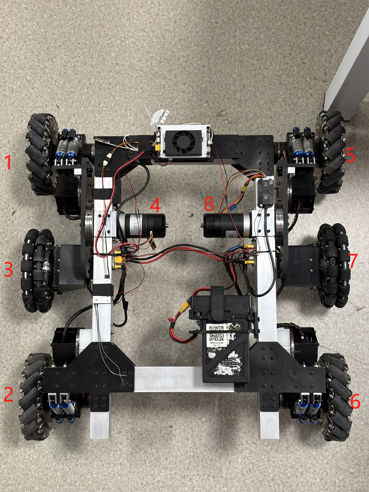

# 2025 赛季工程 ｜ `fluorite`

> 为了解决给包和模型起名字的问题，给这辆车起个代号名吧：
>
> CODENAME **fluorite**

## CI status

<table>
<tr>
<td>foxy</td>
<td rowspan=2>
    <a href="https://github.com/XDU-IRobot/engineer-2025/actions/workflows/build_eol.yaml">
        
    </a>
</td>
</tr>
<tr>
<td>galactic</td>
</tr>
<tr>
<td>humble</td>
<td rowspan=4>
    <a href="https://github.com/XDU-IRobot/engineer-2025/actions/workflows/build.yaml">
        
    </a>
</td>
</tr>
<tr>
<td>iron</td>
</tr>
<tr>
<td>jazzy</td>
</tr>
<tr>
<td>rolling</td>
</tr>
</table>

工程车所有功能的开发工作在本仓库进行，包括控制、机械臂运动规划、导航和自动兑换视觉。

## 硬件

- 主控

  - 视觉/导航 `Jetson xavier nx 8gb` `ip = 10.0.3.101`

  - 控制/机械臂规划 `orangepi 5 8gb` `ip = 10.0.3.102`

- 相机 `大恒水星 MER2-230` `->` `Jetson`。

## 程序使用方法

### 安装依赖

#### 在香橙派(`ubuntu 22.04`)上安装以下软件

- ROS2 `>= humble`

- moveit `apt install ros-humble-moveit*`

- ros2_control `apt install ros-humble-ros2-control*`

- [qpOASES](https://github.com/coin-or/qpOASES)

#### 在 Jetson(`ubuntu 20.04`) 上安装以下软件

- Jetpack `apt install nvidia-jetpack`

- ROS2 `>= galactic`

- [大恒相机驱动 `Galaxy Linux-armhf-Gige-U3 SDK`](https://www.daheng-imaging.com/index.php?m=content&c=index&a=lists&catid=59&czxt=30&sylx=23&syxj=#mmd)

### 编译

```bash
# 按情况，在哪台电脑上编译就选哪个
python3 scripts/build.py -j     # 编译jetson上运行的包
python3 scripts/build.py -o     # 编译香橙派上运行的包
```

### 运行

```bash
source install/setup.bash
# 同上
ros2 launch fluorite_bringup opi.launch.py
ros2 launch fluorite_bringup jetson.launch.py
```

### [可选] 注册 systemd 服务（开机自启）

车目前的状态应该已经注册过，如果板子重新装过系统需要重新配置，执行：

```bash
./scripts/install_service.sh
```

如果不想开机自启，取消注册服务或者暂时 disable 服务均可：

```bash
./scripts/uninstall_service.sh
# or
sudo systemctl disable fluorite_opi.service
sudo systemctl disable fluorite_jetson.service
```

### CAN 总线 设备列表



底盘电机布局如上图

| 设备       | CAN 总线 | master id | slave id | 备注      |
| ---------- | -------- | --------- | -------- | --------- |
| 左前轮     | can0     | 0x201     | 0x200    | 1 号 3508 |
| 左后轮     | can0     | 0x202     | 0x200    | 2 号 3508 |
| 右前轮     | can0     | 0x205     | 0x1ff    | 5 号 3508 |
| 右后轮     | can0     | 0x206     | 0x1ff    | 6 号 3508 |
| 左中轮     | can0     | 0x203     | 0x200    | 3 号 3508 |
| 右中轮     | can0     | 0x207     | 0x1ff    | 7 号 3508 |
| 左抬升机构 | can0     | 0x204     | 0x200    | 4 号 3508 |
| 右抬升机构 | can0     | 0x208     | 0x1ff    | 8 号 3508 |

## 上位机配置

### 8009 #1


