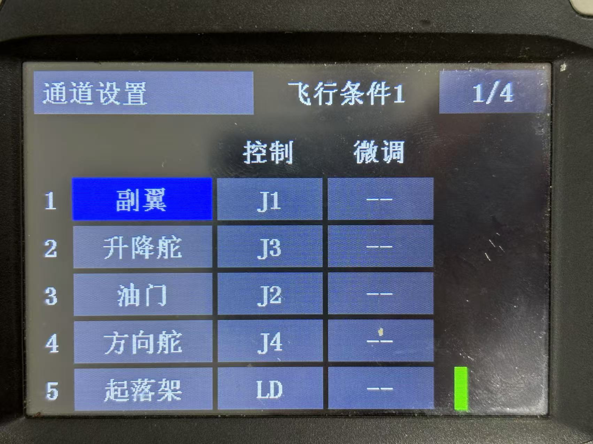
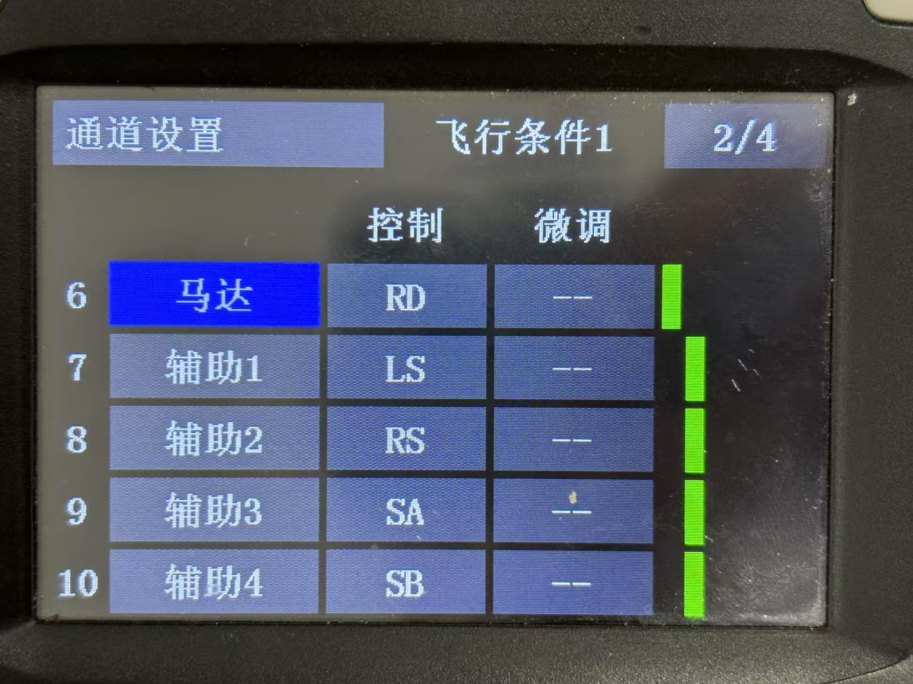
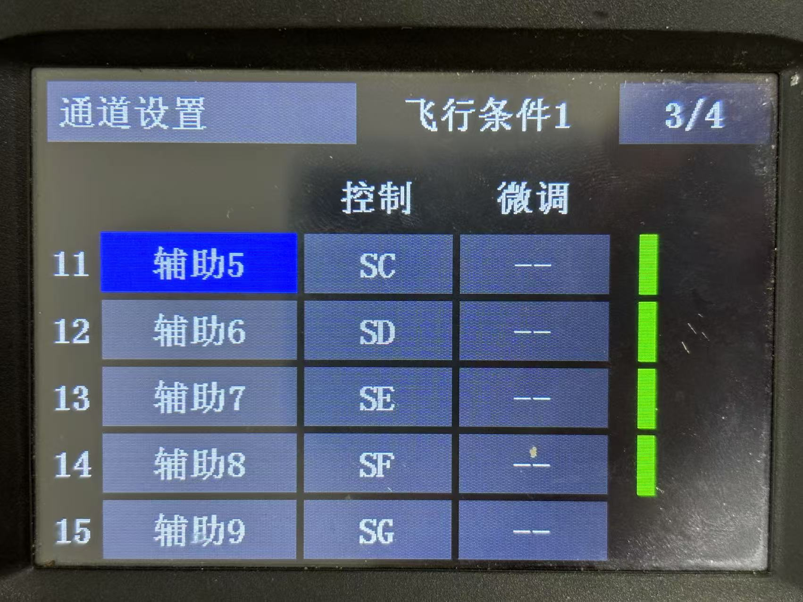
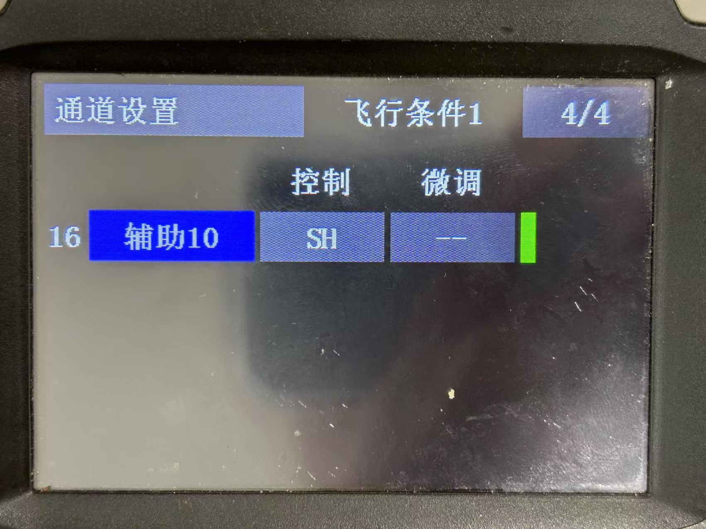
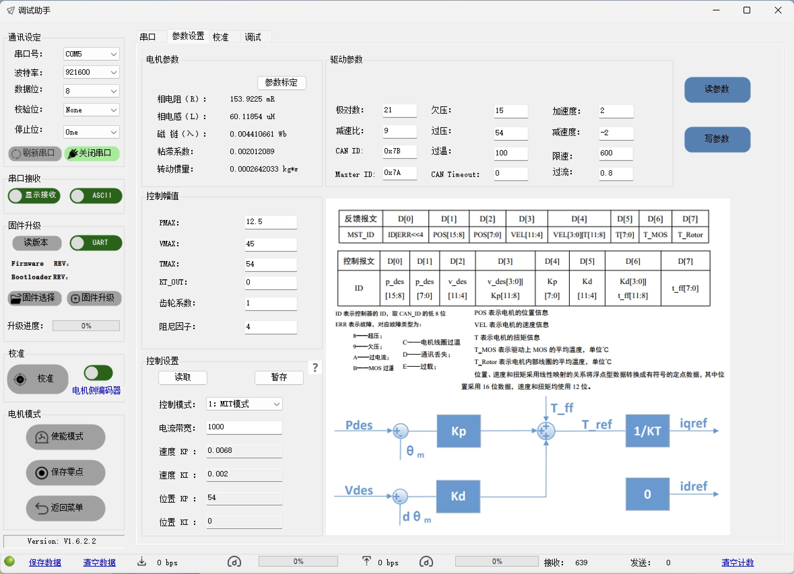

# 2025 赛季工程 ｜ `fluorite`

> 为了解决给包和模型起名字的问题，给这辆车起个代号名吧：
>
> CODENAME **fluorite**

## CI status

<table>
<tr>
<td>foxy</td>
<td rowspan=2>
    <a href="https://github.com/XDU-IRobot/engineer-2025/actions/workflows/build_eol.yaml">
        
    </a>
</td>
</tr>
<tr>
<td>galactic</td>
</tr>
<tr>
<td>humble</td>
<td rowspan=4>
    <a href="https://github.com/XDU-IRobot/engineer-2025/actions/workflows/build.yaml">
        
    </a>
</td>
</tr>
<tr>
<td>iron</td>
</tr>
<tr>
<td>jazzy</td>
</tr>
<tr>
<td>rolling</td>
</tr>
</table>

工程车所有功能的开发工作在本仓库进行，包括控制、机械臂运动规划、导航和自动兑换视觉。

## 硬件

- 主控

  - 视觉 `Jetson xavier nx 8gb` `ip = 10.0.3.101`

  - 控制/机械臂规划/导航 `orangepi 5 8gb` `ip = 10.0.3.102`

- 相机 `大恒水星 MER2-230` `->` `Jetson`。

### PCB

整车用到了 3 块 自行设计的 PCB，PCB 文件使用 git lfs 管理，在仓库里执行`git lfs pull`即可下载：

- orange pi 5 的扩展板 [`pcb/opi5.eprj`](pcb/opi5.eprj)

- 位于底盘的电源继电器板 [`pcb/engineer_2025.eprj`](pcb/engineer_2025.eprj)

- 位于机械臂的电磁阀驱动器/分电板 [`pcb/engineer_2025.eprj`](pcb/engineer_2025.eprj)

## 程序使用方法

### 环境配置

#### 在香橙派(`ubuntu 22.04, RT Kernel`)上：

1. 安装以下软件

   - ROS2 `>= humble`

   - moveit `apt install ros-humble-moveit*`

   - Eigen `apt install libeigen3-dev`

   - [qpOASES](https://github.com/coin-or/qpOASES)

   - [wiringOP](https://github.com/orangepi-xunlong/wiringOP)

2. 执行初始化脚本：

   ```bash
   sudo python3 ./scripts/setup_env.py -o
   ```

#### 在 Jetson(`ubuntu 20.04`) 上：

1. 安装以下软件

   - Jetpack `apt install nvidia-jetpack`

   - ROS2 `>= galactic`

   - [大恒相机驱动 `Galaxy Linux-armhf-Gige-U3 SDK`](https://www.daheng-imaging.com/index.php?m=content&c=index&a=lists&catid=59&czxt=30&sylx=23&syxj=#mmd)

2. 执行初始化脚本：

   ```bash
   sudo python3 ./scripts/setup_env.py -j
   ```

### 编译

```bash
# 按情况，在哪台电脑上编译就选哪个
python3 scripts/build.py -j     # 编译jetson上运行的包
python3 scripts/build.py -o     # 编译香橙派上运行的包
```

### 运行

```bash
source install/setup.bash
# 同上
chrt -f 99 ros2 launch fluorite_bringup opi.launch.py
ros2 launch fluorite_bringup jetson.launch.py
```

### [可选] 注册 systemd 服务（开机自启）

车目前的状态应该已经注册过，如果板子重新装过系统需要重新配置，执行：

```bash
./scripts/install_service.sh
```

如果不想开机自启，取消注册服务或者暂时 disable 服务均可：

```bash
./scripts/uninstall_service.sh
# or
sudo systemctl disable fluorite_opi.service
sudo systemctl disable fluorite_jetson.service
```

## CAN 总线 设备列表

| 设备        | CAN 总线 | master id                                | slave id  | 备注                  |
| ----------- | -------- | ---------------------------------------- | --------- | --------------------- |
| 左前轮      | can0     | 0x201                                    | 0x200     | 1 号 3508，反馈 500hz |
| 左后轮      | can0     | 0x204                                    | 0x200     | 4 号 3508，反馈 500hz |
| 右前轮      | can0     | 0x202                                    | 0x200     | 2 号 3508，反馈 500hz |
| 右后轮      | can0     | 0x203                                    | 0x200     | 3 号 3508，反馈 500hz |
| 左前舵      | can0     | 0x205                                    | 0x1ff     | 1 号 6020，反馈 500hz |
| 左后舵      | can0     | 0x208                                    | 0x1ff     | 4 号 6020，反馈 500hz |
| 右前舵      | can0     | 0x206                                    | 0x1ff     | 2 号 6020，反馈 500hz |
| 右后舵      | can0     | 0x207                                    | 0x1ff     | 3 号 6020，反馈 500hz |
| 大 yaw 轴   | can1     | 0x51, 0x61, 0x71, 0x81, 0x91, 0xa1, 0xb1 | 0x32~0x3a | 1 号 本末 p1010a_111  |
| pitch #1    | can1     | 0xc1                                     | 0xc2      | DM-J8009-2EC          |
| pitch #2    | can1     | 0xc3                                     | 0xc4      | DM-J8009-2EC          |
| pitch #3    | can1     | 0xc5                                     | 0xc6      | DM-J8009-2EC          |
| 末端 yaw #1 | can1     | 0xc7                                     | 0xc8      | DM-J4310-2EC          |
| 末端 pitch  | can1     | 0xc9                                     | 0xca      | DM-J4310-2EC          |
| 末端 yaw #2 | can1     | 0x205                                    | 0x1ff     | 1 号 6020，反馈 500hz |

## 上位机/硬件配置

### 遥控器通道设置






### 8009 #1


